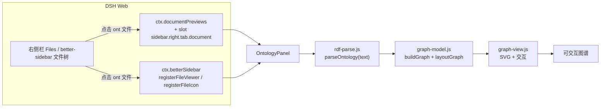

<div align="center">


# dsh-ontology-viewer

**在 DeepSeek Harness 里直接"点开本体文件，看图谱"。**

把 `.ttl`、`.owl`、`.rdf`、`.jsonld`、`.nt`、`.n3` 等 RDF / 本体文件从"一屏文本"变成可交互的节点-关系图——零依赖、本地解析、不上传任何数据。

[](https://github.com/a158070653-hash/dsh-ontology-viewer/actions/workflows/ci.yml)
[](LICENSE)
[](package.json)
[](https://github.com/deepseek-ai/deepseek-harness)

</div>

---

**相关文档**：[接入笔记（如何写同类插件）](docs/integration.md) · [参与贡献](CONTRIBUTING.md) · [更新日志](CHANGELOG.md)

## 目录

- [为什么做这个](#为什么做这个)
- [功能特性](#功能特性)
- [安装](#安装)
- [使用](#使用)
- [支持的格式](#支持的格式)
- [实现原理](#实现原理)
- [性能与边界](#性能与边界)
- [目录结构](#目录结构)
- [开发](#开发)
- [常见问题](#常见问题)
- [验证状态](#验证状态)
- [English](#english)

## 为什么做这个

本体 / RDF 文件（Turtle、RDF/XML、JSON-LD……）用文本看很难建立结构直觉：一个 `owl:Class` 继承了几层、谁引用了谁、某个属性挂在哪、空白节点代表什么限制。通用图数据库工具要么要导入、要么要起服务，而日常就是"想快速看一眼这份本体长什么样"。

这个插件把"看一眼"变成一次点击：文件树里点开本体文件，右侧预览区直接就是力导向图，能缩放、拖拽、搜索、点节点看 IRI 和字面量。

## 功能特性

- **两个入口，随装随用**
  - DSH 自带右侧栏文档预览（Files 页签）：本体文件默认渲染为图谱，仍可下拉切回宿主纯文本。
  - [dsh-better-sidebar](https://github.com/omdsh-dev/DSH-better-sidebar) 已安装时：它的文件树里点这些文件直接打开图谱页签，并显示图谱文件图标。
- **四种序列化本地解析**：Turtle / N-Triples / RDF-XML(OWL) / JSON-LD，按后缀判断 + 内容嗅探，坏文件保留已解析部分并给出行号提示。
- **为"看本体"设计的建模**：字面量不进图（挂在节点详情里）、平行边合并计数、`rdf:first/rest` 列表管道不画成边、节点按类/属性/个体/空白节点/外部引用着色区分。
- **可交互**：缩放、平移、拖拽节点、悬停高亮邻居、搜索跳转、焦点模式、节点详情（完整 IRI、类型、字面量、入/出边/度数）、一键重新布局 / 适配视图。
- **确定性布局**：固定种子 + mulberry32 伪随机，同样输入永远同样画面；不跑持续物理动画，不烧 CPU。
- **贴合宿主**：只用 `--dsw-alias-*` 主题令牌，明暗主题自适应；文案走 DSH locale（中/英），可随语言切换。
- **零运行时依赖**：解析器、图模型、渲染全部自带；不引入 d3/cytoscape 等库，不请求网络。

## 安装

> 前置：DSH 的 Web 类 profile（标准 `web` 部署或桌面版）。插件是标准 bundle：安装会同时写入依赖与 `dsh.profile.bundles`，装完刷新页面生效。

**方式一：从 GitHub 安装（推荐）**

`<profile>` 换成你正在用的 profile 名：标准 Web 部署通常是 `web`，DSH 桌面版通常是 `desktop`（`~/.dsh/profiles/` 下能看到已有名字）。

```bash
# 跟随 main
dsh plugin --profile <profile> add https://github.com/a158070653-hash/dsh-ontology-viewer.git

# 或锁定发布版本
dsh plugin --profile <profile> add https://github.com/a158070653-hash/dsh-ontology-viewer.git#v1.0.0
```

这条命令会 clone 仓库、按 `files` 打包安装，并把 `dsh-ontology-viewer` 追加进该 profile 的 `dsh.profile.bundles`——不需要再手动改 profile 配置。

**方式二：预构建 tarball（Release 资产，免构建授权）**

每次发版都会把 `npm pack` 产物作为固定文件名 `dsh-ontology-viewer.tgz` 挂到 Release 上：

```bash
dsh plugin --profile <profile> add https://github.com/a158070653-hash/dsh-ontology-viewer/releases/latest/download/dsh-ontology-viewer.tgz
```

**方式三：本地开发安装（link，改代码即时生效）**

```bash
dsh plugin --profile <profile> add link:<本仓库绝对路径>
```

**方式四：先克隆再安装**

```bash
git clone https://github.com/a158070653-hash/dsh-ontology-viewer.git
dsh plugin --profile <profile> add link:<克隆下来的绝对路径>
```

**可选增强**：安装 [dsh-better-sidebar](https://github.com/omdsh-dev/DSH-better-sidebar) 后，底部文件树的入口也会生效，并显示 `.ttl/.owl/...` 的图谱图标。不装也能用——插件会退化为只注册 DSH 自带预览。

安装完成后刷新一次 DSH 页面（Client 模块只在页面加载时注册）。设置 → 插件里可以看到「本体图谱查看器」，可随时停用。


## 使用

1. 打开右侧栏 → **文件（Files）**，选到任意工作区。
2. 点开一个本体文件，例如本仓库自带的示例（把它复制进你的工作区即可）：
   - [`examples/pizza.ttl`](examples/pizza.ttl) — Turtle：类层次 + 对象/数据属性 + 内联空白节点
   - [`examples/people.nt`](examples/people.nt) — N-Triples：人物与组织关系
   - [`examples/library.rdf`](examples/library.rdf) — RDF/XML：图书馆借阅
   - [`examples/courses.jsonld`](examples/courses.jsonld) — JSON-LD：课程目录
   - [`examples/zoo.owl`](examples/zoo.owl) — OWL/RDF-XML：动物分类 + `owl:Restriction`
3. 预览区默认显示「本体图谱」；预览头部下拉框可切回「纯文本」。

| 操作 | 效果 |
| --- | --- |
| 悬停节点 | 高亮 1 跳邻居与相连边，其余淡出 |
| 拖动节点 / 拖动空白处 | 手动摆位 / 平移画布 |
| 滚轮 | 以光标为锚点缩放（15%–400%） |
| 单击节点 | 右侧详情面板：完整 IRI、`rdf:type`、字面量属性表、出/入边与度数 |
| 搜索框 | 按标签或 IRI 匹配，`Enter` 跳到第一个命中，`Esc` 清空 |
| 「只看选中节点周围」 | 焦点模式，只画选中节点的 1 跳子图 |
| 「重新布局」/「适配视图」 | 重新计算布局 / 缩放到整图 |
| 「标签」 | 节点文字开关（大图默认只在高缩放级别显示标签） |
| 点击邻居类型 IRI | 在图内跳转并居中该节点（若存在） |

## 支持的格式

| 后缀 | 解析器 | 覆盖范围 |
| --- | --- | --- |
| `.ttl` `.turtle` `.n3` `.trig` | Turtle | `@prefix`/`PREFIX`、`@base`、`;` 与 `,` 列表、空白节点 `[ ]`、集合 `( )`、语言标签、`^^` 类型、数字/布尔简写、`\u` 转义；TriG 的图标签忽略、内部三元组保留 |
| `.nt` `.nq` | N-Triples | 每行一条语句、`\u` 转义、空白节点；`.nq` 的第 4 列图名丢弃 |
| `.rdf` `.owl` `.xml` | RDF/XML | `rdf:about`/`rdf:ID`/`rdf:nodeID`、`rdf:resource`、`rdf:parseType`（Resource/Literal/Collection）、`rdf:li`、`xml:base`/`xml:lang`、xmlns 前缀解析 |
| `.jsonld` | JSON-LD | `@context`（前缀 / term / `@vocab` / `@base`）、`@graph`、`@id`、`@type`、`@value` + `@language`、`@container`（`@set`/`@list`/`@language`/`@index`） |

**故意不接管 `.json`**：普通 JSON 文件仍然走宿主的代码/JSON 查看器，只有 `.jsonld` 后缀进入图谱。

格式未知时按内容嗅探：`{` / `[` → JSON-LD，`<?xml` / `<rdf:` → RDF/XML，`@prefix` / `PREFIX` → Turtle。

解析永不抛异常：坏文件返回已解析的三元组 + 带行号的 `warnings` / `errors`，在视图顶部「解析提示」条里展示。

## 实现原理



插件是标准 DSH bundle，包含一个几乎为空的 Host 半侧（只为在插件清单里有一行可开关记录）和一个浏览器 Client 模块：

- Client 模块由 `src/*.js` 通过 `build/build.mjs` 拼成单文件 `client.js`（DSH 每个 Client 模块只加载一个文件，浏览器模块表也只解析 `react` 这类包名，不支持相对 import）。
- 源码保持普通 ES module，方便 Node 直接 import 做单元测试；构建时去掉 `import`/`export` 后在同一个闭包里拼接，共享 `React`。
- DSH 自带预览这条路径使用 `loading: 'bytes-complete'`：图谱需要整份文档，而不是文本预览按需分页的行。
- 布局是本地确定性计算：mulberry32 伪随机 + Fruchterman–Reingold 力导向；断开的分量先按网格播种，再跑力导向，避免整体挤成一团。

## 性能与边界

- 字面量不进图 → 图只画实体与关系，避免被字符串淹没。
- 平行边合并并计数；`rdf:first` / `rdf:rest` 不画成边。
- 上限：解析 12 万三元组、展示 1500 节点（按度数保留，超出提示「输入已截断」）、源文件 12 MB。
- 自带示例实测：每个文件 1–12 ms 完成解析+建图+布局；2 万条语句（6 万三元组）合成压力用例约 320 ms（解析排在首帧之后，不阻塞白屏）。
- 1200–1500 节点布局约 0.2 s（Node 实测），浏览器同量级。
- 不做：`.omn`（Manchester 语法）、RDFa、远程 `@context`；JSON-LD 的 `@reverse`/`@included`/`@nest` 与 keyword 别名不展开（给警告）；RDF/XML 的 `rdf:ID` 具体化未实现。

## 目录结构

```
dsh-ontology-viewer/
├─ package.json          # dsh.bundle.patch + dsh.client 声明
├─ cordis.patch.yml      # bundle 挂载：插入一条 Host 行
├─ index.js              # Host 半侧（空实现，只为可开关）
├─ client.js             # 构建产物：浏览器 Client 模块（勿手改）
├─ src/
│  ├─ rdf-parse.js       # Turtle / N-Triples / RDF-XML / JSON-LD 解析（零依赖，2620 行）
│  ├─ graph-model.js     # 三元组 → 图模型 + 确定性布局（827 行）
│  ├─ graph-view.js      # React + SVG 交互视图，主题令牌配色（899 行）
│  └─ main.js            # apply(ctx)：注册两个扩展点 + 加载状态外壳（486 行）
├─ build/build.mjs       # 单文件 Client 模块构建
├─ locale/{en,zh}.json   # 插件清单里的标题/描述
├─ examples/             # 5 个可直接点开的示例本体
├─ tests/                # 46 个 Node 单元测试
├─ scripts/              # i18n 覆盖检查、端到端统计与压力脚本
├─ docs/integration.md   # 接入笔记：DSH 文件预览插件怎么写
├─ CONTRIBUTING.md       # 贡献指南（构建、约定、PR 检查清单）
├─ CHANGELOG.md
├─ assets/icon-180.png   # 插件市场用的 180×180 位图图标（由 icon.svg 同几何渲染）
├─ .github/workflows/    # CI：构建一致性 + 测试 + i18n
├─ icon.svg
└─ LICENSE
```

## 开发

```bash
# 依赖：Node.js >= 22（`--test` 的 glob 参数自 v22 起支持）；无需 npm install（零运行时依赖）
npm test            # 46 个单元测试
npm run build       # 由 src/ 重新生成 client.js
npm run build:check # 校验 client.js 与 src/ 一致（CI 用）
npm run check       # 语法 + 构建一致性 + 测试
npm run i18n        # 校验视图文案 key 与中英词典一致
npm run stats       # 示例文件与压力用例的端到端统计
npm run pack:release # 生成发版用 dsh-ontology-viewer.tgz（固定文件名，挂 Release）
```

提交前请跑 `npm run check`，并提交更新后的 `client.js`——它是安装后真正被浏览器加载的文件。贡献流程与代码约定见 [CONTRIBUTING.md](CONTRIBUTING.md)；想了解这两个宿主扩展点的完整契约（`ctx.documentPreviews` / `ctx.betterSidebar` / Client 模块格式），见 [docs/integration.md](docs/integration.md)。

维护约定：

- `client.js` 由 `build/build.mjs` 生成，不要手改；改功能请改 `src/`。
- 新增视图文案：同时在 `src/main.js` 的 `ZH` / `EN` 字典里加 key，然后 `npm run i18n`。
- 新增支持的格式：改 `src/rdf-parse.js` 的 `detectFormat` 与对应解析器，并在 `src/main.js` 的 `ONTOLOGY_EXTENSIONS` 里登记后缀。
- 颜色只用宿主主题令牌（`--dsw-alias-*`），不要写死颜色；如需新色用 `color-mix()` 从品牌色派生。

## 常见问题

**问：为什么我打开 `.json` 文件没变化？**  
答：为了防止接管工作区里所有 JSON 文件，插件只匹配 `.jsonld`。把文件后缀改成 `.jsonld`，或从预览头部下拉框手动选择「本体图谱」（如果该文件被判定为文本的话）。

**问：为什么预览区只显示纯文本？**  
答：检查文件后缀是否在上面支持列表里；或刷新页面让 Client 模块重新加载；或在预览头部下拉框里选择「本体图谱」。

**问：图谱太大/太慢？**  
答：超过 1500 节点会按度数截断并提示；可以先用搜索或「只看选中节点周围」聚焦局部。解析上限是 12 万三元组。

**问：能改默认打开方式吗？**  
答：插件注册的渲染器优先级是 `extension` 档，默认排在宿主纯文本前面。想固定用文本，在预览头部下拉框选择一次即可（按文件标签记忆）。

**问：dark / light 主题会跟随吗？**  
答：会。所有颜色都取自 `--dsw-alias-*` 主题令牌，每个令牌都带字面量兜底。

## 验证状态

仓库内已验证（可复现）：

- 46 个 Node 单元测试全绿：解析器 18、图模型 17、5 个真实示例文件的端到端 7、打包接线 4；CI（GitHub Actions）在 Node 22 上跑同一套检查；
- 干净 clone 后 `npm run build:check` 通过（`client.js` 与 `src/` 字节一致，`.gitattributes` 固定 LF）；`node --check client.js` 通过；产物无残留 `import`/`export`；
- 用 fake `ctx` 加载**打包后的** `client.js` 并执行 `apply`，确认四类注册（document preview 元数据、`sidebar.right.tab.document` 正文、better-sidebar viewer/icon、locale 词典）符合契约；
- 从 GitHub 安装（隔离的临时 profile 实测）：`dsh plugin --profile <p> add <仓库地址>` 成功，依赖以 `github:` 形式装入手，`dsh.profile.bundles` 自动追加 `dsh-ontology-viewer`，`dsh --dump-config` 能看到本插件的 bundle 行；
- 从 Release 的预构建 tarball 安装（隔离的临时 profile 实测）：`dsh plugin --profile <p> add https://github.com/a158070653-hash/dsh-ontology-viewer/releases/latest/download/dsh-ontology-viewer.tgz` 成功，bundle 同样自动登记；
- 在真实 DSH 实例中安装后：Host 行 `fiberPhase: active`，Client 侧 `sidebar.right.tab.document` 槽位出现 `dsh-ontology-viewer/graph` 且 `active: true`——说明 Client 模块确实在浏览器中加载并执行了。

尚未验证（作者环境无浏览器控制权限，无法截图）：

- 图谱在页面中的实际视觉呈现、深/浅主题下的对比度、不同窗口宽度下的布局；
- 点到真实文件时的最终画面。

如果你发现视觉问题，欢迎提 issue，附上文件片段和截图；改 `src/graph-view.js` 的 `CSS` 常量后 `npm run build` 即可。

## English

**dsh-ontology-viewer** is a plugin for [DeepSeek Harness](https://github.com/deepseek-ai/deepseek-harness). Open `.ttl`, `.owl`, `.rdf`, `.jsonld`, `.nt`, `.n3` files from the file tree and the right-sidebar preview renders their RDF triples as an interactive force-directed graph instead of raw text.

- Two surfaces: DSH's built-in document preview (`ctx.documentPreviews` + `sidebar.right.tab.document`) and [dsh-better-sidebar](https://github.com/omdsh-dev/DSH-better-sidebar) file viewers (optional).
- Parsers for Turtle / N-Triples / RDF-XML / JSON-LD, with no runtime dependencies and no network access.
- Hover to highlight neighbours, drag to pin nodes, wheel to zoom, click a node for its IRI, `rdf:type`, literals and edge counts; search, focus mode, re-layout.
- Deterministic layout (fixed seed, mulberry32), host theme tokens only, zh/en UI.

Install: `dsh plugin --profile <profile> add https://github.com/a158070653-hash/dsh-ontology-viewer.git` (`web` for the standard web deployment, `desktop` for the desktop app), then refresh the DSH page. Try the files in [`examples/`](examples).

## 参与贡献

欢迎 issue / PR。改动流程、代码约定和 PR 检查清单见 [CONTRIBUTING.md](CONTRIBUTING.md)；写同类插件可参考 [docs/integration.md](docs/integration.md)。

## License

[Apache-2.0](LICENSE).

