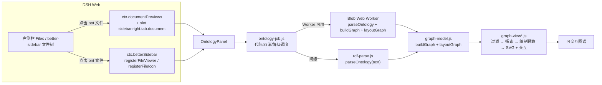

<div align="center">


# dsh-ontology-viewer

**在 DeepSeek Harness 里直接"点开本体文件，看图谱"。**

把 `.ttl`、`.owl`、`.rdf`、`.jsonld`、`.nt`、`.n3` 等 RDF / 本体文件从"一屏文本"变成可交互的节点-关系图——零依赖、本地解析、不上传任何数据。

[](https://github.com/a158070653-hash/dsh-ontology-viewer/actions/workflows/ci.yml)
[](https://awesome-dsh-plugin.com)
[](LICENSE)
[](package.json)
[](https://github.com/deepseek-ai/deepseek-harness)

</div>

---

**当前版本：1.1.0** · **相关文档**：[DSH 兼容、依赖与升级](docs/compatibility.md) · [接入笔记](docs/integration.md) · [参与贡献](CONTRIBUTING.md) · [更新日志](CHANGELOG.md)

## 目录

- [为什么做这个](#为什么做这个)
- [功能特性](#功能特性)
- [安装](#安装)
- [使用](#使用)
- [支持的格式](#支持的格式)
- [实现原理](#实现原理)
- [性能与边界](#性能与边界)
- [目录结构](#目录结构)
- [开发](#开发)
- [常见问题](#常见问题)
- [验证状态](#验证状态)
- [English](#english)

## 为什么做这个

本体 / RDF 文件（Turtle、RDF/XML、JSON-LD……）用文本看很难建立结构直觉：一个 `owl:Class` 继承了几层、谁引用了谁、某个属性挂在哪、空白节点代表什么限制。通用图数据库工具要么要导入、要么要起服务，而日常就是"想快速看一眼这份本体长什么样"。

这个插件把"看一眼"变成一次点击：文件树里点开本体文件，右侧预览区直接就是力导向图，能缩放、拖拽、搜索、点节点看 IRI 和字面量。

## 功能特性

- **两个入口，随装随用**
  - DSH 自带右侧栏文档预览（Files 页签）：本体文件默认渲染为图谱，仍可下拉切回宿主纯文本。
  - [dsh-better-sidebar](https://github.com/omdsh-dev/DSH-better-sidebar) 已安装时：它的文件树里点这些文件直接打开图谱页签，并显示图谱文件图标。
- **四种序列化本地解析**：Turtle / N-Triples / RDF-XML(OWL) / JSON-LD，按后缀判断 + 内容嗅探；坏文件保留已解析部分，诊断按类型聚合（无法保留的命名图标为 unknown、远程上下文跳过、RDF/XML 具体化未实现等），不再静默丢语义。
- **为"看本体"设计的建模**：字面量不进图（挂在节点详情里）、平行边合并计数、`rdf:first/rest` 列表管道不画成边、节点按类/属性/个体/空白节点/外部引用着色区分。
- **可探索的图谱**：按节点类型 / 关系类型 / 关系方向过滤；从选中节点做 1–5 跳邻域探索（出边/入边/双向，支持预算截断后继续展开）；一键回到完整视图；所有过滤只影响显示，不改 RDF 数据。
- **可交互**：缩放、平移、拖拽节点、悬停高亮邻居、搜索结果列表选择、按谓词分组的入/出边详情、一键重新布局 / 适配视图；点击关系端点可在图内定位。
- **显示预算清晰可见**：解析三元组、图模型节点/字面量、SVG 绘制边分层预算；发生裁剪时显示"保留 X / 上限 Y"或"已绘制 X / 共 Y"，并给出原因。
- **确定性布局 + 后台计算**：固定种子 + mulberry32 伪随机，同样输入永远同样画面；解析/建模/布局优先在 Blob Web Worker 中完成，Worker 不可用时降级为主线程分片布局并明确提示。
- **贴合宿主**：只用 `--dsw-alias-*` 主题令牌，明暗主题自适应；文案走 DSH locale（中/英），可随语言切换。
- **零运行时依赖**：解析器、图模型、渲染全部自带；不引入 d3/cytoscape 等库，不请求网络。

## 安装

> 发布验证基线：**DSH Desktop 0.2.2-rc.1（Windows x64）**；该次运行使用 Node.js 24.21.0。包声明的 Node.js 要求仍是 `>=22`，不把 24.21.0 当成最低版本。可选 `dsh-better-sidebar` 入口已在 0.30.1 验收。其它 DSH 版本、Web 部署、操作系统/架构未由本次发布证据覆盖。插件是标准 bundle：安装会同时写入依赖与 `dsh.profile.bundles`，装完刷新页面生效。

**方式一：从 GitHub 安装（推荐）**

`<profile>` 换成你正在用的 profile 名（`~/.dsh/profiles/` 下能看到已有名字）。本次 1.1.0 真实页面验收使用 DSH Desktop 的 `desktop` profile；Web 部署与其它 profile/宿主版本不在已验证兼容范围内。

```bash
# 跟随 main
dsh plugin --profile <profile> add https://github.com/a158070653-hash/dsh-ontology-viewer.git

# 或锁定发布版本
dsh plugin --profile <profile> add https://github.com/a158070653-hash/dsh-ontology-viewer.git#v1.1.0
```

这条命令会 clone 仓库、按 `files` 打包安装，并把 `dsh-ontology-viewer` 追加进该 profile 的 `dsh.profile.bundles`——不需要再手动改 profile 配置。

**方式二：预构建 tarball（Release 资产，免构建授权）**

每次发版都会把 `npm pack` 产物作为固定文件名 `dsh-ontology-viewer.tgz` 挂到 Release 上：

```bash
dsh plugin --profile <profile> add https://github.com/a158070653-hash/dsh-ontology-viewer/releases/latest/download/dsh-ontology-viewer.tgz
```

**方式三：本地开发安装（link，改代码即时生效）**

```bash
dsh plugin --profile <profile> add link:<本仓库绝对路径>
```

**方式四：先克隆再安装**

```bash
git clone https://github.com/a158070653-hash/dsh-ontology-viewer.git
dsh plugin --profile <profile> add link:<克隆下来的绝对路径>
```

**可选增强**：安装 [dsh-better-sidebar](https://github.com/omdsh-dev/DSH-better-sidebar) 后，底部文件树的入口也会生效，并显示 `.ttl/.owl/...` 的图谱图标。不装也能用——插件会退化为只注册 DSH 自带预览。

安装完成后刷新一次 DSH 页面（Client 模块只在页面加载时注册）。设置 → 插件里可以看到「本体图谱查看器」，可随时停用。


## 使用

1. 打开右侧栏 → **文件（Files）**，选到任意工作区。
2. 点开一个本体文件，例如本仓库自带的示例（把它复制进你的工作区即可）：
   - [`examples/pizza.ttl`](examples/pizza.ttl) — Turtle：类层次 + 对象/数据属性 + 内联空白节点
   - [`examples/people.nt`](examples/people.nt) — N-Triples：人物与组织关系
   - [`examples/library.rdf`](examples/library.rdf) — RDF/XML：图书馆借阅
   - [`examples/courses.jsonld`](examples/courses.jsonld) — JSON-LD：课程目录
   - [`examples/zoo.owl`](examples/zoo.owl) — OWL/RDF-XML：动物分类 + `owl:Restriction`
3. 预览区默认显示「本体图谱」；预览头部下拉框可切回「纯文本」。

| 操作 | 效果 |
| --- | --- |
| 悬停节点 | 高亮 1 跳邻居与相连边，其余淡出 |
| 拖动节点 / 拖动空白处 | 手动摆位 / 平移画布 |
| 滚轮 | 以光标为锚点缩放（15%–400%） |
| 单击节点 | 右侧详情面板：完整 IRI、`rdf:type`、字面量属性表、按谓词分组的出/入边（可折叠、可显示更多）、度数 |
| 搜索框 | 结果列表（最多 500 条匹配、展示前 20 条），方向键选择、`Enter` 确认、`Esc` 清空 |
| 「过滤」 | 按节点类型、关系类型、相对选中节点的方向过滤；显示可见/总数，支持清除恢复 |
| 「邻域探索」 | 从选中节点展开 1–5 跳，支持出/入/双向；预算截断时可继续展开，可一键回到完整视图 |
| 「重新布局」/「适配视图」 | 重新计算布局 / 缩放到整图 |
| 「标签」 | 节点文字开关（大图默认只在高缩放级别显示标签） |
| 点击关系端点 / 邻居类型 IRI | 在图内选中并居中该节点（若存在） |
| 「来源」 | 打开来源面板：已载入文件、格式、状态、三元组/错误/警告数、截断与磁盘变化；可添加本地文件、移除、重载、选择联合或单文件工作集 |
| 「关系网络 / 类层级 / 分层关系」 | 三种视图共享同一实体身份与来源数据；类层级基于显式 `rdfs:subClassOf`/`rdfs:subPropertyOf`，分层图按所选谓词与方向布局并折叠循环；点击循环组会列出成员并可直接选中成员 |
| 「导出」 | 导出当前视图为 SVG/PNG；范围可选「当前视口」或「当前显示集合完整布局」，导出不增加被过滤/折叠/预算隐藏的内容 |
| 「共享」（来源面板） | 在同一 Session 的面板间共享已解析来源（只共享解析快照，不发送源文本）；最后一个面板关闭即清空 |
| 节点来源（类层级/分层视图） | 查看节点的完整来源、出现角色、语句数，以及每条关系的 s/p/o、来源列表与命名图状态 |

> 来源面板与详情展示的是**已接纳数据来源**，不等于输入完整性：解析截断、被拒绝/超出预算的文件、未加载或已移除的来源都不在其中；详情里的“已接纳来源不代表输入完整”提示即为该语义。

> 多文件：打开主文件后，在「来源」面板点击「添加文件」可把本地 RDF 文件加入当前工作区。加入的文件只在当前页面内存中，不会上传；本地文件重载时需要重新选择文件。DSH 工作区内逐目录复选加载（方案 A）依赖官方 `workspaceFiles` 能力，目前保留为可选路线，需在真实环境完成授权/取消/读取验证后才启用；在此之前使用本地文件选择（方案 B）。

## 支持的格式

| 后缀 | 解析器 | 覆盖范围 |
| --- | --- | --- |
| `.ttl` `.turtle` `.n3` `.trig` | Turtle | `@prefix`/`PREFIX`、`@base`、`;` 与 `,` 列表、空白节点 `[ ]`、集合 `( )`、语言标签、`^^` 类型、数字/布尔简写、`\u` 转义；TriG 图标签保留为语句的 `graph` 字段（默认图/命名图/空白图名），无法识别的图上下文标为 `unknown` 并给出分类诊断 |
| `.nt` `.nq` | N-Triples | 每行一条语句、`\u` 转义、空白节点；`.nq` 的第 4 列图名保留为语句的 `graph` 字段 |
| `.rdf` `.owl` `.xml` | RDF/XML | `rdf:about`/`rdf:ID`/`rdf:nodeID`、`rdf:resource`、`rdf:parseType`（Resource/Literal/Collection）、`rdf:li`、`xml:base`/`xml:lang`、xmlns 前缀解析；未实现的具体化/parseType 会给出分类诊断 |
| `.jsonld` | JSON-LD | `@context`（前缀 / term / `@vocab` / `@base`）、`@graph`（含顶层 `@graph` 兄弟键）、`@id`、`@type`、`@value` + `@language`、`@container`（`@set`/`@list`/`@language`/`@index`）；`@reverse` 等不支持结构会给出分类诊断；带 `@id` 的命名 `@graph` 保留语句但标为 `unknown` 图身份并诊断 |

**故意不接管 `.json`**：普通 JSON 文件仍然走宿主的代码/JSON 查看器，只有 `.jsonld` 后缀进入图谱。

格式未知时按内容嗅探：`{` / `[` → JSON-LD，`<?xml` / `<rdf:` → RDF/XML，`@prefix` / `PREFIX` → Turtle。

解析永不抛异常：坏文件返回已解析的三元组 + 带行号的原始消息，并在视图顶部「解析提示」条里按分类 code 聚合展示（同一类只列次数与最多 3 条样本）；内置上限防止警告洪泛、超深嵌套与超长字面量拖垮页面。

**身份与 Base IRI**：插件把三种标识分开——`navigationAddress`（DSH 会话路由，例如 `dsh-resource://…`，只用于访问/授权/导航）、`absolutePath`（宿主确认的真实文件路径）与 `rdfBase`（相对 IRI 的解析基准）。DSH 路由不会被当作 RDF Base；原生预览优先从宿主资源元数据取得 `absolutePath`，better-sidebar 使用其提供的绝对路径，两个入口共用一个路径→`file:` URI 转换（Windows 盘符/UNC/POSIX、空格与特殊字符、`%` 不重复解码）。文档内 `@base` / `xml:base` / JSON-LD `@base` 仍按各自作用域优先生效。没有可靠 Base 时相对 IRI 保持原文、产生 `base-unavailable` 诊断，并在合并层限制在来源内部，不会被错误地跨文件合并；浏览器本地文件若声明了有效绝对 Base，仍可正常跨文件关联。

**跨文件合并**：相同完整 IRI 合并为同一实体；空白节点按来源隔离；重复语句去重但保留全部来源、出现次数与命名图身份；来源移除/重载按来源贡献更新，不累积旧数据。合并基于保留的解析语句（L0），不从已裁剪的图模型逆推。

## 实现原理



插件是标准 DSH bundle，包含一个几乎为空的 Host 半侧（只为在插件清单里有一行可开关记录）和一个浏览器 Client 模块：

- Client 模块由 `src/*.js` 通过 `build/build.mjs` 拼成单文件 `client.js`（DSH 每个 Client 模块只加载一个文件，浏览器模块表也只解析 `react` 这类包名，不支持相对 import）。
- 源码保持普通 ES module，方便 Node 直接 import 做单元测试；构建时去掉 `import`/`export` 后在同一个闭包里拼接，共享 `React`。
- DSH 自带预览这条路径使用 `loading: 'bytes-complete'`：图谱需要整份文档，而不是文本预览按需分页的行。
- 布局是本地确定性计算：mulberry32 伪随机 + Fruchterman–Reingold 力导向；断开的分量先按网格播种，再跑力导向，避免整体挤成一团。

## 性能与边界

- 字面量不进图 → 图只画实体与关系，避免被字符串淹没。
- 平行边合并并计数；`rdf:first` / `rdf:rest` 不画成边。
- 分层预算（超出时都有可见提示，不静默裁剪）：
  - 解析：12 万三元组（达到上限后所有格式停止解析）；
  - 建模：1500 节点（按度数保留）、每节点 60 条字面量、单条字面量 16384 字符；
  - 绘制：默认最多 6000 条边（选中/搜索命中/高度数优先），SVG 元素量受此约束；
  - 探索：每跳 300 个新增节点 / 800 条边，最多 5 跳，预算截断后可继续展开；
  - 源文件：12 MiB，按 **UTF-8 字节**计算（原生预览入口；better-sidebar 入口受其宿主 5 MiB 读取阈值限制）。
- 多文件工作区（候选护栏，可被后续基准下调）：最多 16 个文件、合计接纳源 24 MiB、全工作区保留 12 万条语句出现记录；视图切换复用已解析来源，不会重新解析未变文件；类树/分层图的展示引用与循环组有独立上限。
- 解析/建模/布局优先在后台 Worker 执行；多文件时由同一个 Workspace Worker 缓存已解析来源，组合与布局复用该缓存。Worker 不可用时降级为主线程分片布局（只让布局非阻塞，解析/建模仍同步）并收紧预算、明确提示。降级模式的预算是 6 万三元组 / 800 节点 / 3000 绘制边。
- `npm run bench` 提供小型/中型/接近上限/高密度/异常五类夹具的分阶段基准（解析、建图、320/1000 次迭代布局、图规模、内存、序列化成本），并输出多文件 compose/树/分层投影的一组基准；仓库内记录的基准结果见 `openspec/changes/archive/2026-11-10-enhance-ontology-graph-core/verification.md`。
- 导出：SVG 使用静态元素白名单与文本转义，不包含脚本、外部资源、事件属性或 DTD；PNG 在浏览器内由同一 SVG 栅格化，分配前检查总像素与单边上限（16M 像素 / 8192 单边），失败时回退 SVG。导出文本会剥离控制字符与内部分隔标记，界面与可访问名称同样不会出现这些字符。下载只能确认「已发起」，浏览器不会报告文件是否保存成功；「复制 SVG」失败时会显示只读文本框，可手动全选复制。

> 导出文件在哪里：保存位置和对话框由宿主决定。验收时 DSH Desktop 在系统「下载」目录先生成 `<uuid>.tmp`，确认原生「另存为」后变为最终文件；对话框曾出现在其他显示器。请检查系统下载目录或保存窗口，不要仅凭“已发起下载”判断保存成功，也不要给未知或未完成的 `.tmp` 文件随意改后缀。可用「复制 SVG」后在文本编辑器另存作为回退。
- 不做：`.omn`（Manchester 语法）、RDFa、远程 `@context`；JSON-LD 的 `@reverse`/`@included`/`@nest` 等结构不展开（给分类诊断），带 `@id` 的命名 `@graph` 标为 `unknown`；RDF/XML 的 `rdf:ID` 具体化未实现（给诊断）；不做 OWL 推理、SPARQL、`owl:imports` 联网加载或自动扫描工作区。

## 目录结构

```
dsh-ontology-viewer/
├─ package.json          # dsh.bundle.patch + dsh.client 声明
├─ cordis.patch.yml      # bundle 挂载：插入一条 Host 行
├─ index.js              # Host 半侧（空实现，只为可开关）
├─ client.js             # 构建产物：浏览器 Client 模块（勿手改）
├─ src/
│  ├─ rdf-parse.js          # Turtle / N-Triples / RDF-XML / JSON-LD 解析（零依赖，诊断与上限）
│  ├─ ontology-identity.js  # 跨文件实体键：空白节点/未解析相对 IRI 的来源隔离与防碰撞编码
│  ├─ graph-model.js        # 三元组 → 图模型；来源贡献过滤/探索/绘制预算/布局任务
│  ├─ ontology-workspace.js # 多文件 L0 来源缓存、准入预算、语句合并与来源表
│  ├─ ontology-views.js     # 类/属性层级树、SCC、分层关系图投影与确定性布局
│  ├─ graph-export.js       # 显示场景快照、安全 SVG、PNG 像素预算与栅格化
│  ├─ ontology-job.js       # 计算任务状态机、Worker 客户端、工作区协议、主线程降级调度
│  ├─ worker-entry.js       # Worker 侧入口（仅构建期内嵌，不进入主闭包）
│  ├─ graph-view-style.js   # CSS、常量、kind 元数据
│  ├─ graph-view-controls.js# 过滤/探索/搜索/工具栏
│  ├─ graph-view-details.js # 节点详情与连接分组
│  ├─ graph-view.js         # SVG 编排、缩放拖拽、状态与提示
│  ├─ graph-view-multiview.js # 视图切换、来源面板、类树、分层图、来源详情、导出菜单
│  ├─ graph-view-workspace.js # 工作区控制器：主文件 + 附加来源 + 三视图 + 导出
│  └─ main.js               # apply(ctx)：注册两个扩展点 + 工作区外壳
├─ build/build.mjs          # 单文件 Client 模块构建（含内嵌 Worker 源）
├─ locale/{en,zh}.json      # 插件清单里的标题/描述
├─ examples/                # 5 个可直接点开的示例本体
├─ tests/                   # Node 单元测试（解析/模型/任务/视图状态/示例/打包）
├─ scripts/                 # i18n 覆盖检查、端到端统计、性能基准
├─ docs/integration.md      # 接入笔记：DSH 文件预览插件怎么写
├─ CONTRIBUTING.md          # 贡献指南（构建、约定、PR 检查清单）
├─ CHANGELOG.md
├─ assets/icon-180.png      # 插件市场用的 180×180 位图图标（由 icon.svg 同几何渲染）
├─ .github/workflows/       # CI：构建一致性 + 测试 + i18n
├─ icon.svg
└─ LICENSE
```

## 开发

```bash
# 依赖：Node.js >= 22（`--test` 的 glob 参数自 v22 起支持）；无需 npm install（零运行时依赖）
npm test            # 当前全部单元测试
npm run build       # 由 src/ 重新生成 client.js（含内嵌 Worker 源）
npm run build:check # 校验 client.js 与 src/ 一致（CI 用）
npm run check       # 语法 + 构建一致性 + 测试
npm run i18n        # 校验全部 UI 模块文案 key 与中英词典一致
npm run stats       # 示例文件与压力用例的端到端统计
npm run bench       # 五类夹具的分阶段性能基准（opt-in，不进 CI）
npm run pack:release # 生成发版用 dsh-ontology-viewer.tgz（固定文件名，挂 Release）
```

提交前请跑 `npm run check`，并提交更新后的 `client.js`——它是安装后真正被浏览器加载的文件。贡献流程与代码约定见 [CONTRIBUTING.md](CONTRIBUTING.md)；想了解这两个宿主扩展点的完整契约（`ctx.documentPreviews` / `ctx.betterSidebar` / Client 模块格式），见 [docs/integration.md](docs/integration.md)。

维护约定：

- `client.js` 由 `build/build.mjs` 生成，不要手改；改功能请改 `src/`。
- 新增视图文案：同时在 `src/main.js` 的 `ZH` / `EN` 字典里加 key，然后 `npm run i18n`。
- 新增支持的格式：改 `src/rdf-parse.js` 的 `detectFormat` 与对应解析器，并在 `src/main.js` 的 `ONTOLOGY_EXTENSIONS` 里登记后缀。
- 颜色只用宿主主题令牌（`--dsw-alias-*`），不要写死颜色；如需新色用 `color-mix()` 从品牌色派生。

## 常见问题

**问：为什么我打开 `.json` 文件没变化？**  
答：为了防止接管工作区里所有 JSON 文件，插件只匹配 `.jsonld`。把文件后缀改成 `.jsonld`，或从预览头部下拉框手动选择「本体图谱」（如果该文件被判定为文本的话）。

**问：为什么预览区只显示纯文本？**  
答：检查文件后缀是否在上面支持列表里；或刷新页面让 Client 模块重新加载；或在预览头部下拉框里选择「本体图谱」。

**问：图谱太大/太慢？**  
答：超过分层预算会按确定性规则裁剪并明确提示（解析 12 万三元组、1500 节点、绘制 6000 条边）；可以先用搜索、过滤或「邻域探索」聚焦局部。解析/建模/布局优先在后台 Worker 中执行；Worker 不可用时自动降级为主线程分片布局并按提示收紧预算。

**问：为什么两个入口能打开的文件大小不同？**
答：原生预览入口受插件自身 12 MiB（UTF-8 字节）解析上限约束；better-sidebar 入口受其宿主 5 MiB 读取阈值约束，超过后宿主只提供文件大小。插件不修改宿主或其它插件的读取配置，只如实提示当前入口的上限。

**问：能改默认打开方式吗？**  
答：插件注册的渲染器优先级是 `extension` 档，默认排在宿主纯文本前面。想固定用文本，在预览头部下拉框选择一次即可（按文件标签记忆）。

**问：dark / light 主题会跟随吗？**  
答：会。所有颜色都取自 `--dsw-alias-*` 主题令牌，每个令牌都带字面量兜底。

## 验证状态

仓库内已验证（可复现）：

- 当前全部 Node 单元测试通过（解析 / 图模型 / 计算任务 / 视图状态 / 5 个真实示例文件的端到端 / 打包接线；数量随演进，以 `npm test` 为准）；CI（GitHub Actions）在 Node 22 上跑同一套检查；
- 干净 clone 后 `npm run build:check` 通过（`client.js` 与 `src/` 字节一致，`.gitattributes` 固定 LF）；`node --check client.js` 通过；产物无残留 `import`/`export`，内嵌 Worker 源随构建确定性生成；
- 用 fake `ctx` 加载**打包后的** `client.js` 并执行 `apply`，确认四类注册（document preview 元数据、`sidebar.right.tab.document` 正文、better-sidebar viewer/icon、locale 词典）符合契约；
- `npm run bench` 可在相同机器上对比改造前后的解析/建图/布局/序列化成本（本仓库 Change 的基准记录见 `openspec/changes/archive/2026-11-10-enhance-ontology-graph-core/verification.md`）；
- 从 GitHub 安装（隔离的临时 profile 实测）：`dsh plugin --profile <p> add <仓库地址>` 成功，依赖以 `github:` 形式装入手，`dsh.profile.bundles` 自动追加 `dsh-ontology-viewer`，`dsh --dump-config` 能看到本插件的 bundle 行；
- 从 Release 的预构建 tarball 安装（隔离的临时 profile 实测）：`dsh plugin --profile <p> add https://github.com/a158070653-hash/dsh-ontology-viewer/releases/latest/download/dsh-ontology-viewer.tgz` 成功，bundle 同样自动登记；
- 在真实 DSH 实例中安装后：Host 行 `fiberPhase: active`，Client 侧 `sidebar.right.tab.document` 槽位出现 `dsh-ontology-viewer/graph` 且 `active: true`——说明 Client 模块确实在浏览器中加载并执行了。

1.1.0 的真实页面验收在 DSH Desktop 0.2.2-rc.1（Windows x64）完成，覆盖的功能与限制分别列在下方。宿主注册成功与 Node 测试通过不替代视觉/交互验收，也不代表其它 DSH 版本已通过。

逐项记录见 [多视图工作区验收归档](openspec/changes/archive/2026-11-11-add-ontology-multiview-workspace/verification.md)：

- 已用 Node 测试覆盖：双入口 Base 适配与路径编码、跨文件合并/移除/重载、空白节点隔离、命名图保留、类层级（多重继承/循环/预算）、分层图（SCC/布局/预算）、来源贡献过滤、SVG 安全与 PNG 像素预检、Worker 协议（解析/组合/缓存复用）、共享注册表隔离与生命周期、视图状态矩阵、导出场景一致性、组件级状态与可访问名称；
- 已在真实 DSH 页面取得证据：多文件合并与来源过滤、来源面板与共享开关、类树搜索/键盘/属性模式/展开、分层方向图例/关系标签/空态/循环组成员面板（鼠标与键盘）、关系详情与“显示更多”分页、跨视图共享搜索、SVG（网络/类树/分层）与 PNG 实际栅格化并发起下载、浅色/深色主题、中英文切换、575px 窄栏详情抽屉与焦点恢复、导出产物字节校验（PNG 签名/IHDR/IEND；样例另存于 Change 的 `evidence/`）、500 类压力下的导入/内存/长任务采样；导出期间无外部请求；
- **better-sidebar 双入口已真机验收**：`dsh-better-sidebar@0.30.1` 生效后，其文件树双击 `pizza.ttl` 会以本插件的 viewer 渲染（`data-ontology-source`），节点/边/三元组与原生预览一致（25/25、35/35、73），并验证了三视图切换、多文件 A/B 合并与移除、5/12 MiB 上限提示；
- **未验证 / 未启用**：DSH `workspaceFiles` 逐目录复选的多文件入口（该验收 profile 能力不可用，使用浏览器本地文件选择）、持续内存泄漏定论（目前只有峰值与有限时间窗采样）。better-sidebar 入口中的同名异目录、空/错文件、纯文本切换、更新/重载、缩放/拖拽/搜索/快捷键未逐项重复走查；共享组件的原生入口与自动化覆盖不等于这些 better-sidebar 组合均已验收。
- **导出下载链路已真机闭环**：三视图 SVG/PNG 共 6 个文件通过原生「另存为」确认保存到系统下载目录并逐一核对尺寸与内容（网络 575×1133/575×1154、类层级 102×98、分层 521×621），样例见 Change 的 `evidence/`；并记录宿主行为——确认前文件以 `<uuid>.tmp` 形式留在下载目录。

如果你发现视觉问题，欢迎提 issue，附上文件片段和截图；改 `src/graph-view.js` 的 `CSS` 常量后 `npm run build` 即可。

## English

**dsh-ontology-viewer** is a plugin for [DeepSeek Harness](https://github.com/deepseek-ai/deepseek-harness). Open `.ttl`, `.owl`, `.rdf`, `.jsonld`, `.nt`, `.n3` files from the file tree and the right-sidebar preview renders their RDF triples as an interactive graph instead of raw text.

### Compatibility

- Release verification baseline: **DSH Desktop 0.2.2-rc.1 on Windows x64**. The recorded run used Node.js 24.21.0; the package requirement remains Node.js `>=22`.
- Optional `dsh-better-sidebar` integration was verified with version **0.30.1**. It is not a required dependency.
- This evidence does not establish compatibility with other DSH versions, web deployments, operating systems, or architectures. Check the target host before deployment.

- Two surfaces: DSH's built-in document preview (`ctx.documentPreviews` + `sidebar.right.tab.document`) and [dsh-better-sidebar](https://github.com/omdsh-dev/DSH-better-sidebar) file viewers (optional).
- Parsers for Turtle / N-Triples / RDF-XML / JSON-LD, with no runtime dependencies and no network access; semantic losses are reported as grouped diagnostics instead of being silently dropped.
- Hover to highlight neighbours, drag to pin nodes, wheel to zoom, click a node for its IRI, `rdf:type`, literals and predicate-grouped relations; filter by node/relation type and direction, explore 1–5 hop neighbourhoods, search with a selectable result list, re-layout.
- Layer-aware budgets (triples / nodes / literals / drawn edges) are always visible; parse, model and layout prefer a Blob Web Worker and degrade to chunked main-thread layout with a clear notice and tighter budgets when unavailable.
- Deterministic layout (fixed seed, mulberry32), host theme tokens only, zh/en UI.

Install the pinned release: `dsh plugin --profile <profile> add https://github.com/a158070653-hash/dsh-ontology-viewer/releases/download/v1.1.0/dsh-ontology-viewer.tgz`, then reload the Client (restart Desktop if the old module is retained). Use your existing profile; `desktop` was used in the recorded verification. See [compatibility and upgrade notes](docs/compatibility.md) and try the files in [`examples/`](examples).

## 参与贡献

欢迎 issue / PR。改动流程、代码约定和 PR 检查清单见 [CONTRIBUTING.md](CONTRIBUTING.md)；写同类插件可参考 [docs/integration.md](docs/integration.md)。

## License

[Apache-2.0](LICENSE).

